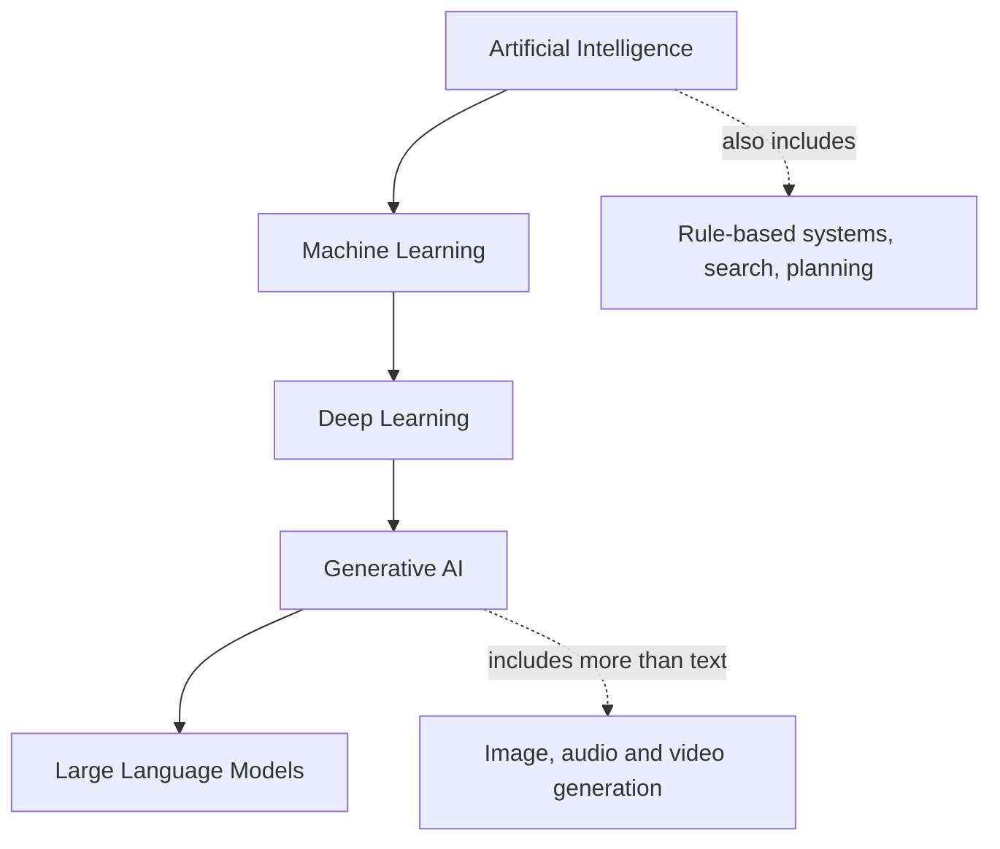
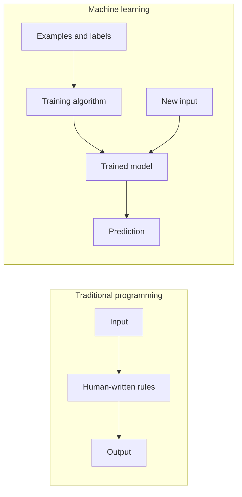
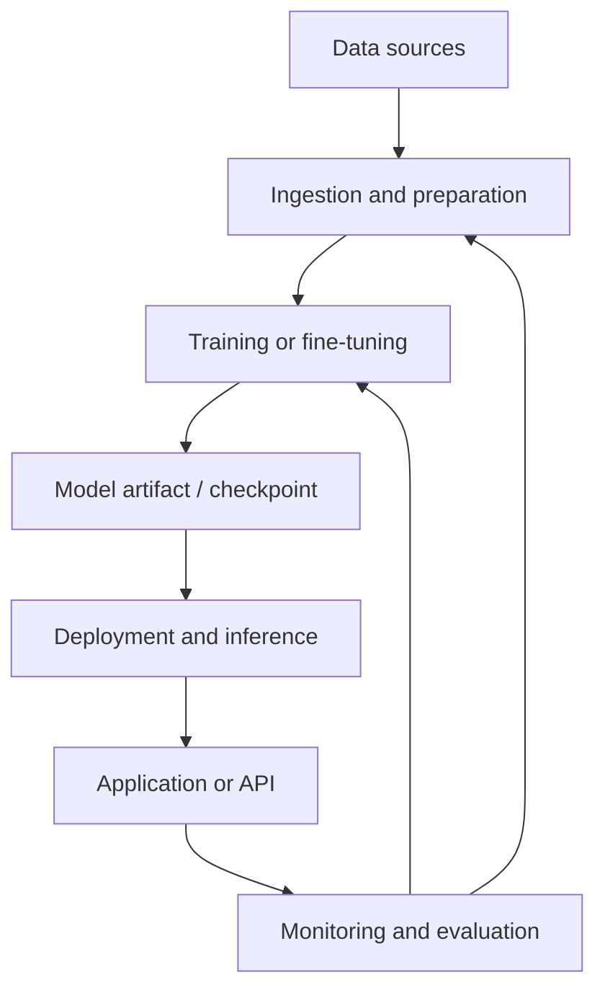

# 01 — What Is Artificial Intelligence?

> **Learning path:** AI Infrastructure / MLOps  
> **Phase:** 1 — Artificial Intelligence Fundamentals  
> **Lesson:** 01  
> **Status:** Complete — knowledge check passed (6/6)  
> **Audience:** Infrastructure / DevOps engineers moving into AI infrastructure

## Learning objectives

By the end of this lesson, you should be able to explain AI; distinguish AI, Machine Learning (ML), Deep Learning (DL), Generative AI, and Large Language Models (LLMs); describe traditional programming versus ML; identify the three common ML approaches; and explain where AI infrastructure fits into an AI lifecycle.

## 1. What is Artificial Intelligence?

**Artificial Intelligence (AI)** is the broad field of building computer systems that perform tasks that normally require aspects of human intelligence.

Examples include image recognition, language understanding and generation, prediction, recommendations, anomaly detection, and planning.

AI does not necessarily mean a machine thinks or understands in the same way a human does. In engineering, we care about inputs, outputs, behavior, limitations, and reliability.

### Infrastructure example

Imagine a Kubernetes platform where pods occasionally enter a crash loop. A monitoring system collects CPU and memory usage, restart counts, OOMKilled events, node pressure, application errors, and deployment changes. An ML model could learn patterns associated with upcoming failures and produce a risk score.

The model is the predictive component. The data pipeline, compute, model deployment, API, monitoring, and operational controls are part of the wider AI system.

## 2. AI, ML, Deep Learning, Generative AI, and LLMs


### Diagram: the AI landscape



This is a simplified learning map, not a strict taxonomy: Generative AI includes non-language models, and AI also includes methods outside ML.


| Term | Meaning | Example |
|---|---|---|
| Artificial Intelligence (AI) | Broad field of systems that perform tasks associated with intelligence | Planning, perception, prediction |
| Machine Learning (ML) | Methods that learn patterns from data | Predicting pod failure from telemetry |
| Deep Learning (DL) | ML methods based on neural networks with multiple layers | Image recognition |
| Generative AI (GenAI) | Models that generate new content such as text, images, audio, or video | Generating a runbook summary |
| Large Language Model (LLM) | A language model trained at large scale to process and generate language | A conversational assistant |

A useful simplified relationship:
- ML is one major area within AI.
- Deep Learning is a family of techniques within ML.
- Much of today's Generative AI is built using deep learning.
- LLMs are one important category of generative models focused on language.

**Nuance:** This is a learning-oriented simplification, not a strict universal taxonomy. Generative AI is not limited to LLMs or text. Image, audio, and video generation are other examples. AI also includes techniques that are not machine learning.

## 3. Traditional Programming vs Machine Learning


### Diagram: explicit rules versus learned patterns




### Traditional programming

An engineer writes explicit instructions and rules. Given inputs, the program applies those rules to produce an output.

```text
Input + Human-written rules → Output
```

Example:

```python
if cpu_usage > 90:
    print("High CPU alert")
```

The threshold and behavior are explicitly defined by the engineer.

### Machine learning

We provide examples or observations to a learning algorithm. During training, it adjusts internal values to learn statistical patterns from the data.

```text
Training data + Learning algorithm → Trained model
New input + Trained model → Prediction
```

Instead of manually defining every combination of CPU, memory, restart count, and error rate that might indicate failure, a model can be trained using historical examples. It may learn combinations of signals associated with failures.

ML does not eliminate engineering rules. Real systems often combine models with validation, thresholds, policy checks, and deterministic application logic.

## 4. Three Common Machine Learning Approaches

### 4.1 Supervised learning

The model learns from **labelled data**: examples where the expected answer is provided.

| CPU usage | Memory usage | Restarts | Failure label |
|---:|---:|---:|---|
| 35% | 40% | 0 | No |
| 92% | 95% | 5 | Yes |
| 55% | 60% | 0 | No |

The model learns a relationship between input signals and the known label.

Typical uses:
- **Classification:** predicting a category, such as failure / no failure.
- **Regression:** predicting a numeric value, such as expected memory consumption.

### 4.2 Unsupervised learning

The model receives data without provided labels and tries to discover structure or patterns.

Example: provide Kubernetes workload metrics without identifying problematic workloads. A model may group workloads with similar behavior or identify observations that look unusual.

Typical uses include clustering, anomaly detection, and discovering patterns in data.

### 4.3 Reinforcement learning

An agent learns by taking actions in an environment and receiving rewards or penalties based on outcomes.

Example: an agent experiments with resource allocation in a simulated cluster. It receives a reward for meeting workload demand efficiently and a penalty for violating latency or availability objectives.

Core terms:
- **Agent:** the learner or decision-maker.
- **Environment:** the system it interacts with.
- **Action:** a choice made by the agent.
- **Reward:** feedback about the outcome.
- **Policy:** the strategy used to choose actions.

## 5. Where AI Infrastructure Fits


### Diagram: production AI lifecycle



Monitoring can trigger data-quality investigation, evaluation, retraining, or rollback. Inference is the act of using a trained model to produce outputs; detailed inference engineering is covered later in the dedicated inference phase.


A useful high-level lifecycle:

```text
Data sources
    ↓
Data ingestion and preparation
    ↓
Model training or fine-tuning
    ↓
Model artifact / checkpoint
    ↓
Model deployment and inference infrastructure
    ↓
Application or API consumes predictions
    ↓
Monitoring, evaluation, feedback, and optimization
```

The lifecycle is iterative. Monitoring or new data may trigger evaluation, retraining, or a model update.

### What the AI infrastructure engineer operates

| Area | Infrastructure responsibilities |
|---|---|
| Data pipelines | Reliable ingestion, storage, access, and processing |
| Training | CPU/GPU compute, scheduling, storage, distributed execution |
| Model artifacts | Versioning, registries, storage, access control |
| Model serving | Containers, APIs, inference engines, scaling, availability |
| Observability | Latency, throughput, errors, resource utilization, model quality signals |
| Security | Identity, secrets, network controls, artifact provenance |
| Cost | GPU utilization, autoscaling, capacity planning, workload efficiency |

The role is not necessarily to invent new model architectures. It is to make AI workloads deployable, reliable, scalable, observable, secure, and cost-effective.

### Connect this to DevOps

| Familiar DevOps concept | AI infrastructure counterpart |
|---|---|
| Build artifact | Model artifact / checkpoint |
| Container image registry | Model registry and artifact storage |
| CI/CD pipeline | Model training, evaluation, and deployment pipeline |
| Kubernetes Deployment | Model-serving workload |
| HPA / cluster autoscaler | Inference and GPU capacity scaling |
| Application monitoring | Infrastructure plus model/inference monitoring |
| Rollback to previous image | Rollback to a previous model version |

These are useful analogies, not exact equivalences. A model artifact has additional concerns such as training data, evaluation results, framework/runtime compatibility, and version lineage.

## 6. Key Takeaways

1. AI is the broad field; ML is one approach within it.
2. Deep Learning is a subset of ML based on multi-layer neural networks.
3. Generative AI creates content; LLMs are generative models focused on language.
4. Supervised learning uses labelled examples; unsupervised learning looks for structure in unlabelled data; reinforcement learning learns from actions and rewards.
5. AI infrastructure covers systems around data, training, artifacts, inference, monitoring, security, and cost.
6. Production AI requires both model capability and sound engineering.

## 7. Knowledge Check

**Status: Pending — answer these before marking the lesson complete.**

1. What best describes Machine Learning?
   - A. Writing every rule manually
   - B. Learning patterns from data
   - C. Storing data in a database
   - D. Running containers

2. Deep Learning is:
   - A. A subset of Machine Learning
   - B. A replacement for Kubernetes
   - C. A type of database
   - D. The same as reinforcement learning

3. Supervised learning uses:
   - A. Only random actions
   - B. No data
   - C. Labelled training examples
   - D. Only manually written rules

4. Reinforcement learning learns primarily through:
   - A. Static labels only
   - B. Rewards and penalties from interaction
   - C. SQL queries
   - D. Container logs alone

5. Is every Generative AI model an LLM?
   - A. Yes
   - B. No

6. What is a central responsibility of an AI infrastructure engineer?
   - A. Only designing neural network architectures
   - B. Building and operating reliable, scalable AI workloads
   - C. Manually labelling every dataset
   - D. Replacing every traditional application with AI

**Answer format:** `1-B, 2-A, 3-C, 4-B, 5-B, 6-B`

Do not mark this lesson complete until the answers have been reviewed.

## 8. Interview Prompts

1. What is the difference between AI, ML, and Deep Learning?
2. How is machine learning different from traditional programming?
3. Explain supervised, unsupervised, and reinforcement learning with infrastructure examples.
4. What is the difference between a predictive ML model and a Generative AI model?
5. What components are required to operate a model in production?
6. Which parts of a production AI lifecycle map naturally to DevOps practices, and which introduce new concerns?

## 9. Next Lesson

**Phase 1 — Lesson 02: Traditional Machine Learning Fundamentals**

Planned topics:
- What a dataset is.
- Features vs labels.
- Training, validation, and test datasets.
- Classification vs regression.
- A typical ML workflow.
- How a model learns from examples.
- Basic evaluation concepts and why accuracy alone can be misleading.

We will establish these concepts before moving into neural networks and LLM architecture.

## Progress Tracker

| Phase | Lesson | Status |
|---|---|---|
| 1 — AI Fundamentals | 01 — What Is Artificial Intelligence? | Complete — 6/6 |
| 1 — AI Fundamentals | 02 — Traditional Machine Learning Fundamentals | In progress |
