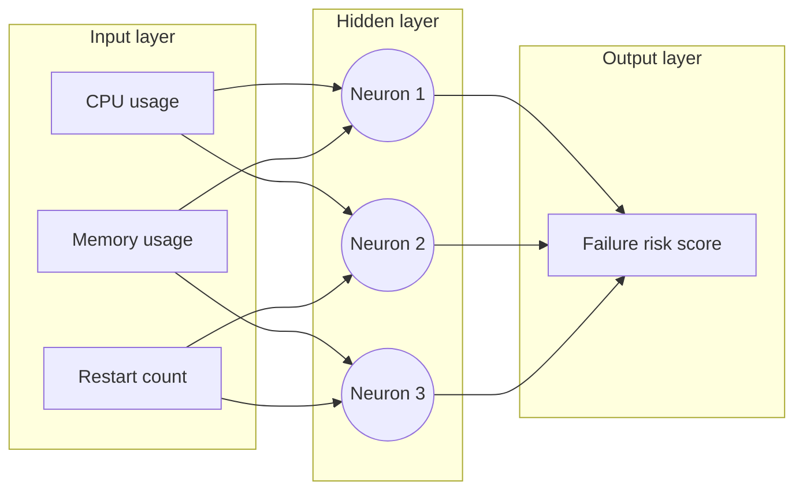
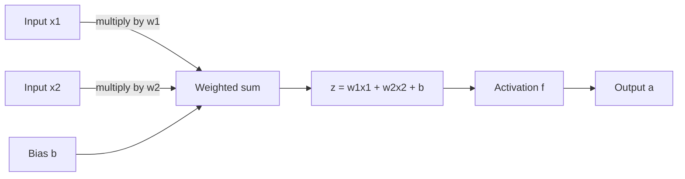
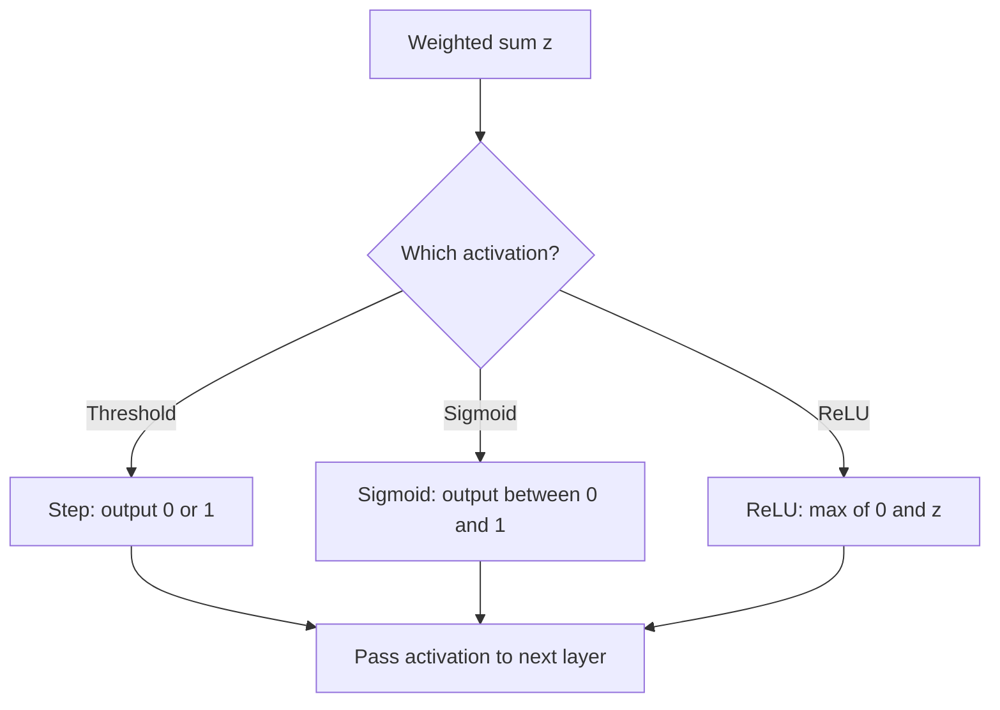
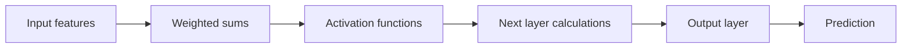

# Lesson 6 — Neural Networks and the Perceptron

> **Learning path:** AI Infrastructure / MLOps  
> **Phase:** 1 — Artificial Intelligence Fundamentals  
> **Lesson:** 06  
> **Status:** Taught — practical exercise and knowledge check pending

## Learning objectives

By the end of this lesson, you should be able to:
- Explain what an artificial neuron and perceptron are.
- Describe inputs, weights, bias, weighted sum, and activation.
- Distinguish input, hidden, and output layers.
- Explain why nonlinear activation functions matter.
- Describe a forward pass.
- Connect neural-network computation to CPU, GPU, RAM, VRAM, storage, and networking.

## 1. What is a neural network?

A **neural network** is a machine-learning model made of connected computational units called **neurons**, organized into layers. During training, it learns patterns by adjusting weights and biases.

Use our Kubernetes pod-failure example. Inputs might include CPU usage, memory usage, and restart count. The network processes these values through layers and produces an output such as a failure score.

A network commonly contains:
- **Input layer:** receives the input features.
- **Hidden layer(s):** perform intermediate calculations and learn useful patterns.
- **Output layer:** produces the final prediction or score.

A network with multiple hidden layers is commonly called a **deep neural network**. Deep learning refers to learning with such multi-layer neural networks.

### Diagram: a simple feed-forward network

Connections between neurons carry learned weights. Each neuron also has a bias and applies an activation function.

## 2. A single artificial neuron (perceptron intuition)

A neuron receives inputs, multiplies them by weights, adds a bias, and applies an activation function.

Weighted sum:

`z = w₁x₁ + w₂x₂ + b`

Activation:

`a = f(z)`

Where:
- `x₁, x₂` are input values.
- `w₁, w₂` are learned weights.
- `b` is a learned bias.
- `z` is the weighted sum before activation.
- `f` is the activation function.
- `a` is the neuron's output.

Weights determine how strongly inputs influence the weighted sum. Bias shifts the weighted sum independently of the input values.

### Diagram: the neuron calculation

## 3. Activation functions

An **activation function** transforms the weighted sum before it is passed to the next layer.

Why it matters: without nonlinear activation functions, stacking linear layers is still mathematically equivalent to one linear transformation. Nonlinear activations allow networks to learn more complex nonlinear relationships.

### Step / threshold function

A threshold-style function returns one of two values, such as 0 or 1. It is useful for understanding the original perceptron idea.

### Sigmoid

Maps a real-valued input into a range between 0 and 1:

`σ(z) = 1 / (1 + e⁻ᶻ)`

It is often used at a binary-classification output layer when a probability-like output is appropriate. A sigmoid output is not automatically well-calibrated.

### ReLU

The Rectified Linear Unit returns zero for negative inputs and the input itself for positive inputs:

`ReLU(z) = max(0, z)`

It is commonly used in hidden layers.

### Diagram: activation function behavior

## 4. From one neuron to a neural network

Each neuron performs a calculation. The output of one layer becomes the input to the next layer. Connections carry learned weights; neurons have biases and activation functions.

For the pod-failure example:
1. Input layer receives CPU, memory, and restart metrics.
2. Hidden neurons combine inputs using weights and biases.
3. Activation functions transform intermediate values.
4. Later layers process those transformed values.
5. Output layer produces a score.

## 5. Forward pass

A **forward pass** is the process of moving input data through the network to calculate an output.

1. Input metrics enter the network.
2. Neurons calculate weighted sums plus bias.
3. Activation functions transform the results.
4. Subsequent layers receive those outputs.
5. The output layer produces a prediction.

For example, an output score of 0.87 could represent an estimated failure probability only if the model's output is defined and appropriately trained. Probability calibration is a separate consideration.

During training, the prediction is compared with the known target using a loss function. The network's parameters are then updated through optimization. Backpropagation—the method used to calculate gradients through layers—is covered in a later, deeper lesson.

### Diagram: forward pass through layers

## 6. Infrastructure impact

| Network activity | Infrastructure impact |
|---|---|
| Input processing | CPU and memory |
| Matrix and tensor calculations | CPU/GPU compute |
| Weights and intermediate activations | RAM / GPU VRAM |
| Training checkpoints | Persistent storage |
| Distributed training | Network bandwidth and coordination |

GPUs are useful because they can perform many numerical operations in parallel. Matrix and tensor operations are central to neural-network computation. We will explore tensors, GPU memory, and parallel computation in the mathematics and GPU sections.

From an infrastructure perspective, training workloads need suitable CPU/GPU resources, memory, data access, checkpoint persistence, observability, and scheduling.

## 7. Practical exercise

A conceptual neuron receives these normalized inputs:

| Input | Value | Weight |
|---|---:|---:|
| CPU usage | 0.8 | 0.5 |
| Memory usage | 0.6 | 0.3 |
| Restart count | 0.9 | 0.2 |

Bias = -0.1.

1. Calculate the weighted sum `z`.
2. Apply ReLU to the result.
3. Is the output positive or zero?
4. What would the neuron do with this output in a multilayer network?
5. What is the purpose of the activation function?

Use:

`z = (0.8 × 0.5) + (0.6 × 0.3) + (0.9 × 0.2) − 0.1`

### Answer guide (for review)

- Weighted sum: 0.4 + 0.18 + 0.18 − 0.1 = **0.66**.
- ReLU(0.66) = **0.66**.
- The output is positive.
- It can be passed as an input/activation to neurons in the next layer.
- The activation introduces a nonlinear transformation, enabling the network to learn nonlinear relationships.

## 8. Knowledge check

**Status: Pending — answer these before marking the lesson complete.**

1. What is an artificial neuron?
   - A. A storage unit for training data
   - B. A computational unit that combines inputs using weights and bias
   - C. A Kubernetes worker node
2. What does a weight control?
   - A. The influence of an input on a neuron's calculation
   - B. The number of training epochs
   - C. The GPU memory limit
3. What is the purpose of an activation function?
   - A. To store model checkpoints
   - B. To introduce nonlinearity into the network
   - C. To split data into training and test sets
4. What does ReLU return when its input is -3?
   - A. -3
   - B. 3
   - C. 0
5. What is a hidden layer?
   - A. A layer between input and output layers
   - B. A database storing model weights
   - C. A layer that only exists during inference
6. What is a forward pass?
   - A. Updating weights using gradients
   - B. Moving input through the network to produce an output
   - C. Saving a model to storage
7. Why are GPUs useful for neural networks?
   - A. They replace the need for training data
   - B. They provide parallel compute for many numerical operations
   - C. They automatically select the best model
8. What is a deep neural network?
   - A. A neural network with multiple hidden layers
   - B. A neural network that runs only on GPUs
   - C. A model with no activation functions

**Answer format:** `1-B, 2-A, 3-B, 4-C, 5-A, 6-B, 7-B, 8-A`

## 9. Interview questions

1. What is a perceptron?
2. What is the difference between a weight and a bias?
3. Why do neural networks need activation functions?
4. What is the difference between input, hidden, and output layers?
5. What happens during a forward pass?
6. Why are GPUs useful for deep learning?
7. What are the infrastructure implications of storing model weights and intermediate activations?

## 10. Next lesson

The next lesson will deepen neural-network training: forward propagation, backpropagation, gradients, and how weights are updated across layers. Later, the LLM module will cover tokenization, embeddings, attention, and Transformers. Detailed model inference and serving remain in the dedicated inference phase of the roadmap.

## Progress

- Lesson taught: Yes
- Practical exercise: Pending review
- Knowledge check: Pending
- Completion status: **Not yet complete**
