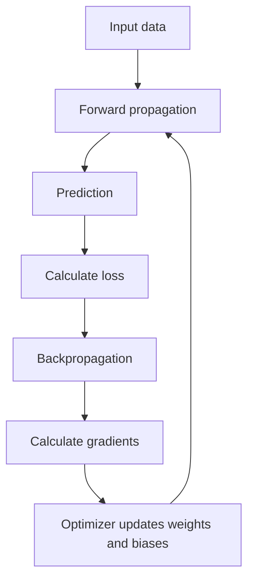
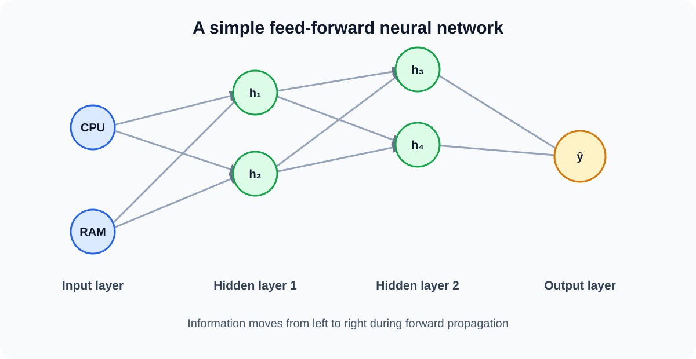
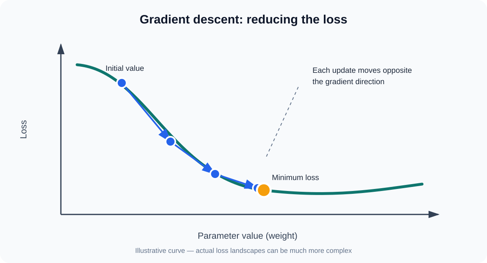
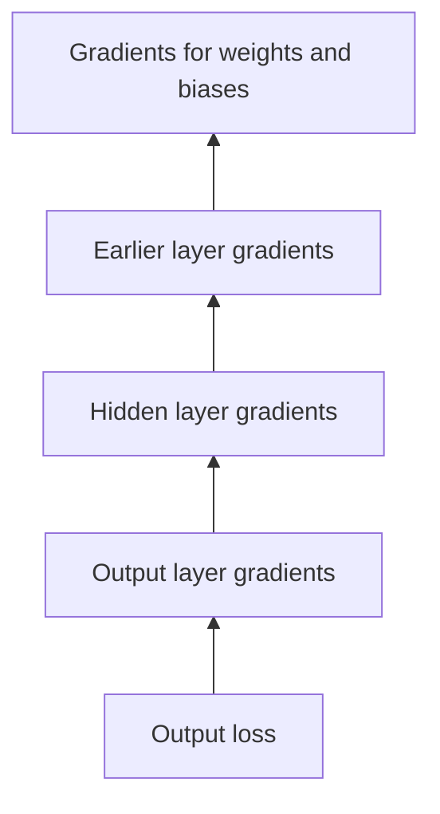
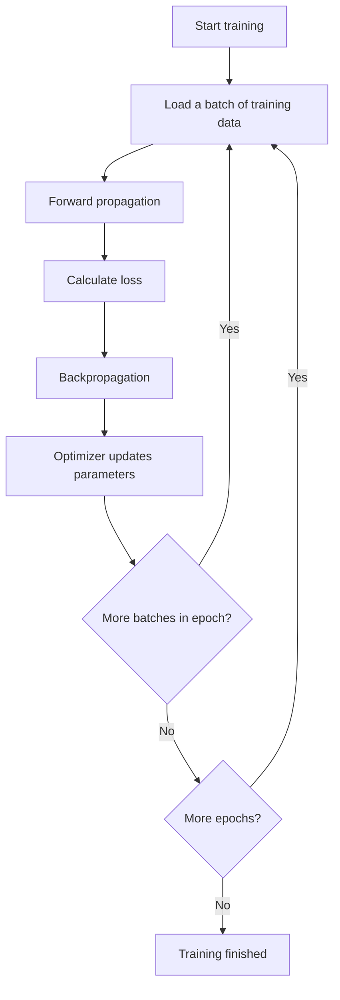

# Lesson 7 — How Neural Networks Learn: Forward Propagation, Backpropagation and Gradients

## 1. Learning objectives

By the end of this lesson, you should be able to:

- Trace how an input travels through a multi-layer neural network.
- Explain the difference between a forward pass and a backward pass.
- Understand what a gradient represents.
- Explain how the chain rule makes backpropagation possible.
- Calculate a simple weight update using gradient descent.
- Describe why training neural networks requires substantial compute and memory.

## 2. First, see the complete learning cycle

A neural network learns by repeatedly making predictions, measuring its errors, and adjusting its parameters.



There are two main directions:

- **Forward:** information travels from the input layer towards the output layer.
- **Backward:** error information travels backwards through the network so the parameters can be adjusted.

This cycle repeats many times during training.

## 3. Forward propagation — making a prediction

Remember the neuron equation from Lesson 6:

[
z = w_1x_1+w_2x_2+b
]

[
a=f(z)
]

Where:

| Symbol | Meaning |
|---|---|
| (x) | Input feature |
| (w) | Weight |
| (b) | Bias |
| (z) | Weighted sum plus bias |
| (f) | Activation function |
| (a) | Neuron output |

A neural network connects many such neurons into layers.



Imagine a network with:

- An input layer receiving CPU and memory metrics.
- A hidden layer learning combinations of those metrics.
- An output layer predicting whether a Kubernetes pod is likely to fail.

Each layer receives the previous layer's output, performs calculations, and passes its result forward.

For example:

```text
Input:
CPU = 80%
Memory = 92%

        ↓

Hidden layer:
Combines input features using weights and biases

        ↓

Output layer:
Failure probability = 0.87
```

The value `0.87` is the model's prediction. It is not automatically a guarantee that the pod will fail; it represents the model's estimated probability, assuming the output has been trained and calibrated appropriately.

**Key point:** During the forward pass, the network uses its current weights and biases. It does not update them yet.

## 4. Loss — measuring how wrong the prediction is

The network needs a way to measure how far its prediction is from the correct answer.

That measurement is called the **loss**.

Suppose:

- Actual target: (y=1) (pod failure)
- Predicted probability: (hat y=0.87)

The model is reasonably close to the target, but there is still some prediction error.

For a simple numerical example, we'll use Mean Squared Error (MSE):

[
L=(hat y-y)^2
]

[
L=(0.87-1)^2=0.0169
]

`Lower loss generally means a better fit to the training target.`

Different tasks use different loss functions. MSE is common for regression; binary cross-entropy is commonly used for binary classification.

## 5. Gradients — figuring out how to improve

This is one of the most important concepts in deep learning.

A **gradient** tells us how the loss changes when a parameter changes.

Think of the loss as a landscape:

- High points represent larger loss.
- Low points represent smaller loss.
- The gradient tells us the direction and rate of steepest increase.
- To reduce loss, gradient descent moves in the opposite direction.



For a parameter (w), its gradient is written as:

[
rac{partial L}{partial w}
]

Read this as: "How much does the loss change when the weight changes?"

- Positive gradient: increasing the weight increases loss locally.
- Negative gradient: increasing the weight decreases loss locally.
- Gradient near zero: the loss is locally changing very little with that parameter.

The gradient is not the weight itself. It is information used to decide how to change the weight.

## 6. Backpropagation — sending error information backwards

Now we reach the core of the lesson.

**Backpropagation** calculates how much each parameter in the network contributed to the final loss.

It starts at the output layer and works backwards through the network using the chain rule from calculus.



Why does it work backwards?

Because the final loss is calculated at the output. To determine how an earlier weight affected that loss, the network applies the chain rule through each operation between that weight and the output.

A simplified chain-rule relationship is:

[
rac{partial L}{partial w}
=
rac{partial L}{partial a}
	imes
rac{partial a}{partial z}
	imes
rac{partial z}{partial w}
]

Each term tells us how one stage affects the next:

1. How the loss changes with the neuron's output.
2. How the output changes with the weighted sum.
3. How the weighted sum changes with the weight.

The network calculates these derivatives layer by layer.

**Important distinction:**

- Backpropagation calculates gradients.
- The optimizer uses those gradients to update parameters.

They work together, but they are not the same operation.

## 7. A numerical example — how a weight actually changes

Let's make backpropagation concrete using a single neuron. We'll use a linear output for this example, without an activation function.

Suppose:

| Parameter | Value |
|---|---:|
| Input (x) | 2 |
| Initial weight (w) | 1 |
| Initial bias (b) | 0 |
| Actual target (y) | 5 |
| Learning rate (eta) | 0.1 |

**Step 1 — Forward pass**

Calculate the prediction:

[
hat y=wx+b
]

[
hat y=(1	imes2)+0=2
]

The model predicted `2`, but the correct answer is `5`.

**Step 2 — Calculate the loss**

For easier differentiation, we'll use half the squared error:

[
L=rac{1}{2}(hat y-y)^2
]

[
L=rac{1}{2}(2-5)^2=4.5
]

**Step 3 — Calculate the gradients**

For this simple neuron:

[
rac{partial L}{partial w}=(hat y-y)x
]

[
rac{partial L}{partial w}=(2-5)	imes2=-6
]

And for the bias:

[
rac{partial L}{partial b}=(hat y-y)=-3
]

So our gradients are:

- Weight gradient = `-6`
- Bias gradient = `-3`

**Step 4 — Update the parameters**

Gradient descent uses:

[
w_{	ext{new}}=w_{	ext{old}}-etarac{partial L}{partial w}
]

[
b_{	ext{new}}=b_{	ext{old}}-etarac{partial L}{partial b}
]

Substitute the values:

[
w_{	ext{new}}=1-(0.1	imes-6)=1.6
]

[
b_{	ext{new}}=0-(0.1	imes-3)=0.3
]

`Updated parameters`

- New weight = `1.6`
- New bias = `0.3`

**Step 5 — Make another prediction**

[
hat y=(1.6	imes2)+0.3=3.5
]

The prediction moved from `2` to `3.5`, closer to the actual target of `5`.

The new loss is:

[
L=rac{1}{2}(3.5-5)^2=1.125
]

`Loss decreased from 4.5 to 1.125.`

That's the basic learning mechanism: calculate, measure, compute gradients, update parameters, repeat.

Real networks have many parameters and multiple layers, but the underlying idea is the same.

## 8. The optimizer — who applies the update?

Backpropagation calculates gradients. The **optimizer** decides how to use them to update weights and biases.

The simplest optimizer is **Stochastic Gradient Descent (SGD)**.

Its update rule is:

[
w_{	ext{new}}=w_{	ext{old}}-eta
abla_w L
]

Here:

- (w) is the parameter being updated.
- (eta) is the learning rate.
- (
abla_w L) is the gradient of the loss with respect to that parameter.

Other commonly used optimizers include:

| Optimizer | Basic idea |
|---|---|
| SGD | Updates parameters using gradients |
| Momentum | Uses a running direction to smooth updates |
| Adam | Adapts updates using moving averages of gradients and squared gradients |
| AdamW | Adam-style optimization with decoupled weight decay |

We'll study optimizer behaviour in more depth later. For now, remember: **the learning rate controls the size of each update.**

A learning rate that is too high can make training unstable or cause it to overshoot. One that is too low can make learning very slow.

## 9. The complete training loop

Now connect everything to the training terminology we've already learned.



Let's connect the terms:

- **Batch:** a group of training examples processed together.
- **Step / iteration:** typically one optimizer update after processing a batch.
- **Epoch:** one complete pass through the training dataset.
- **Learning rate:** controls how large a parameter update is.
- **Training:** repeatedly running the process to improve model parameters.

For example, if you have 10,000 training records and a batch size of 100:

[
	ext{Batches per epoch}=rac{10,000}{100}=100
]

If you train for 20 epochs, assuming every batch produces one optimizer update:

[
	ext{Total updates}=100	imes20=2,000
]

## 10. Infrastructure impact — why this matters to DevOps

This is where neural-network theory becomes infrastructure engineering.

Training a neural network involves large numbers of mathematical operations, especially matrix multiplications.

| Infrastructure resource | What happens during training |
|---|---|
| GPU compute | Performs parallel tensor and matrix operations |
| GPU VRAM | Stores model parameters, activations, gradients and optimizer state |
| System RAM | Holds data-loading buffers and other training-process data |
| CPU | Handles preprocessing, orchestration and parts of the training workload |
| Storage | Holds datasets, checkpoints, logs and model artifacts |
| Network | Moves data between workers in distributed training |

A particularly important distinction:

**Inference versus training**

- During inference, a model generally performs a forward pass to generate a prediction.
- During training, it performs a forward pass, calculates loss, performs backpropagation and updates parameters.

Training therefore needs additional memory for gradients, intermediate activations and often optimizer state.

For your future AI infrastructure work, this is why deploying a model for inference is not the same infrastructure problem as training or fine-tuning it.

## 11. Practical exercise

Let's check whether you can apply the learning cycle yourself.

Imagine you're training a model to predict whether a Kubernetes pod will experience a failure.

The model uses CPU utilization as its input.

Given:

| Item | Value |
|---|---:|
| Input (x) | 3 |
| Initial weight (w) | 0.5 |
| Initial bias (b) | 0 |
| Actual target (y) | 4 |
| Learning rate (eta) | 0.1 |

Use this simplified linear neuron:

[
hat y=wx+b
]

And this loss function:

[
L=rac{1}{2}(hat y-y)^2
]

**Your tasks:**

1. Calculate the initial prediction.
2. Calculate the loss.
3. Calculate the gradient for the weight using ((hat y-y)x).
4. Calculate the gradient for the bias using ((hat y-y)).
5. Update the weight and bias using gradient descent.
6. Calculate the new prediction.
7. Calculate the new loss. Did it decrease?

Try doing the calculations yourself before checking anything. The goal is to understand why the weight changes, not just memorise the formulas.

## 12. Knowledge check

Answer these in your own words. I'll review your answers and explain anything that needs correction.

**Q1.** What is forward propagation, and in which direction does information travel?

**Q2.** What is the purpose of a loss function?

**Q3.** What does a gradient tell us about a model parameter?

**Q4.** What is backpropagation, and why does it work backwards?

**Q5.** What is the difference between backpropagation and an optimizer?

**Q6.** What happens if the learning rate is extremely high?

**Q7.** Why does training generally require more GPU memory than inference?

**Q8.** If a dataset contains 50,000 records and the batch size is 500, how many optimizer updates happen in one epoch, assuming one update per batch?

## 13. Interview questions

Use these to test whether you can explain the concepts without relying on equations.

1. Explain forward propagation and backpropagation in a neural network.
2. What is a gradient, and how is it used during training?
3. Explain the chain rule's role in backpropagation.
4. What is the difference between a loss function and an optimizer?
5. What is the learning rate? What happens when it is too high or too low?
6. Why does training need to store activations and gradients?
7. Why are GPUs useful for training neural networks?

## 14. Lesson 7 completion criteria

- [ ] Understand forward propagation.
- [ ] Understand loss and gradients.
- [ ] Explain backpropagation and the chain rule.
- [ ] Complete the numerical practical exercise.
- [ ] Pass the knowledge check.
- [ ] Explain the infrastructure implications.

**Next lesson:** We'll build on this foundation by exploring deeper neural-network architectures and how multiple layers learn increasingly complex patterns.
