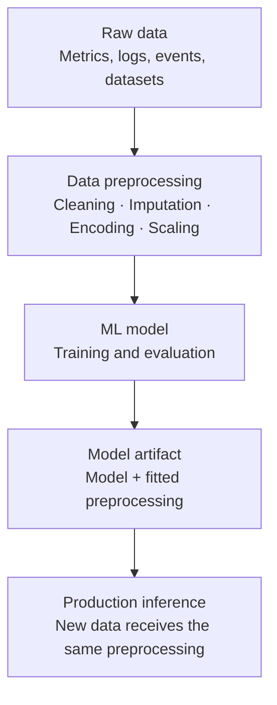
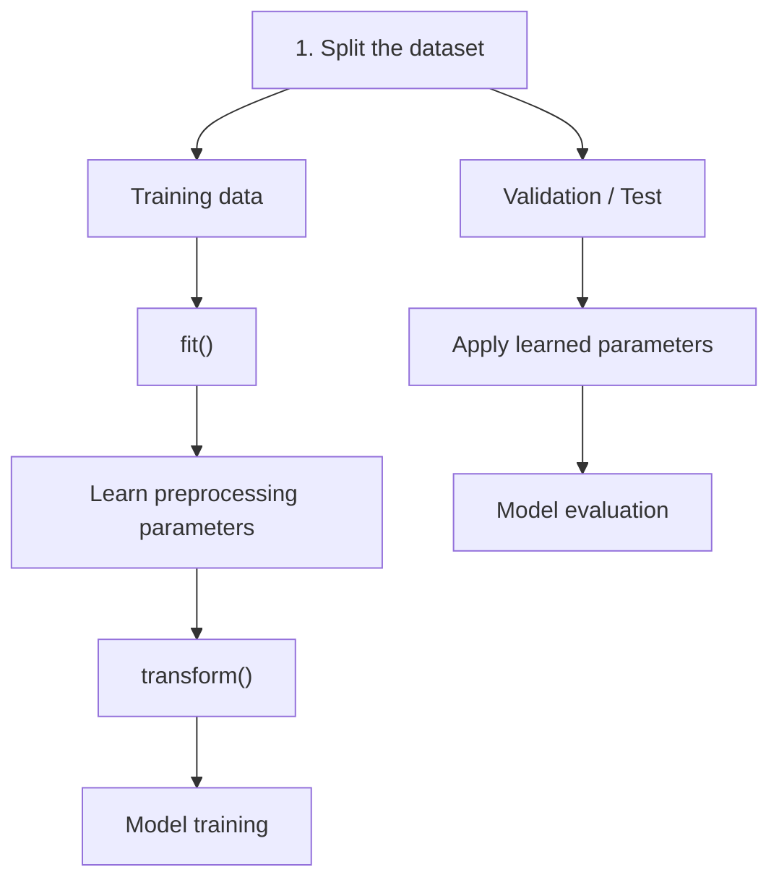
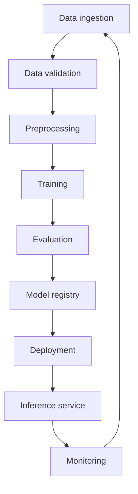

# Phase 1 — AI Fundamentals

## Lesson 9: Data Preprocessing and Data Quality

> **Revised lesson**  
> AI Infrastructure focus

**What you'll learn**

- How raw data becomes model-ready data.
- How preprocessing works in ML pipelines.
- Why data leakage can invalidate a model.
- How preprocessing is packaged with a trained model.
- How to monitor data quality in production.
- How preprocessing fits into MLOps architecture.

**Practical outcome**

Build a preprocessing pipeline using Python and Scikit-learn, then understand how you would deploy and monitor it in production.

# 1. First, understand the problem

Imagine you're building an ML model that predicts whether a Kubernetes pod will experience a resource-related failure.

You collect historical data from your clusters.

Your dataset looks something like this:

| CPU usage | Memory (MB) | Restarts | Node type | Failure |
|---:|---:|---:|---|---|
| 45% | 500 | 0 | General | No |
| 90% | 900 | 5 | Compute | Yes |
| 65% | Missing | 1 | General | No |
| 120% | 1200 | 8 | Compute | Yes |
| 55% | 700 | Missing | General | No |

This data comes from monitoring systems, Kubernetes metrics, logs or telemetry pipelines.

The problem?

Raw production data is rarely perfect.

You may encounter:

- Missing values.
- Incorrect values.
- Different data formats.
- Unexpected categories.
- Inconsistent units.
- Features with very different numerical ranges.

A machine learning model doesn't automatically understand how to handle all these situations.

We need a process to prepare the data before training.

That process is called **data preprocessing**.

### The ML data preparation pipeline



As a DevOps engineer, think of preprocessing as a repeatable build process.

You don't want every developer or inference service manually transforming data differently. You want a consistent, versioned and reproducible pipeline.

# 2. Missing values — what happens when data is absent?

Consider this dataset:

| Pod | CPU usage | Memory |
|---|---:|---:|
| pod-A | 45 | 500 |
| pod-B | 60 | 650 |
| pod-C | Missing | 800 |
| pod-D | 90 | 900 |

CPU usage for pod-C is missing.

Why could this happen?

- Monitoring agent was temporarily unavailable.
- Metrics collection failed.
- A scrape was missed.
- The application didn't expose the metric.
- Data ingestion failed.

A model may not be able to process missing values directly, depending on the algorithm.

We need to decide what to do.

### Common approaches

| Technique | What it does | When useful |
|---|---|---|
| Remove row | Removes record with missing value | Very few missing records |
| Mean imputation | Replaces with average | Relatively clean numerical data |
| Median imputation | Replaces with middle value | Numerical data with extreme values |
| Mode imputation | Uses most common category | Categorical data |
| Constant imputation | Uses a fixed value or marker | When absence itself matters |

**Infrastructure example:**

Suppose CPU metrics are missing because a monitoring agent stopped working.

Replacing missing CPU with zero could be dangerous.

Why?

Because zero CPU means the pod was idle, while missing CPU means we don't know its usage.

Those are two very different conditions.

Sometimes, you should also create a separate feature such as:

```python
cpu_metric_missing = true
```

This allows the model to learn whether missing telemetry itself is associated with failures.

> **Must understand deeply**

The important engineering decision isn't just how to fill missing data. It's understanding what missing data represents.

# 3. Outliers — when values look unusual

Consider CPU usage:

```text
45, 50, 55, 60, 65, 120
```

Most values are between 45 and 65, but one value is 120.

This unusual value is called an **outlier**.

Why could it happen?

- Incorrect metric collection.
- Data corruption.
- Unit conversion problems.
- A genuine infrastructure incident.

Outliers aren't necessarily bad data.

For example, CPU usage above a container's configured limit may indicate an invalid measurement or a data interpretation problem, but an unusual metric during a genuine incident may be exactly the signal we want the model to learn.

Common approaches:

| Technique | Meaning |
|---|---|
| Remove | Delete invalid observations |
| Cap | Restrict extreme values to a threshold |
| Transform | Reduce the influence of extreme values |
| Keep | Retain genuine unusual events |

**Important:** Never automatically remove extreme values from infrastructure datasets. You might remove the very failures your model is supposed to detect.

> **Conceptual understanding**

You should know what outlier detection does and why it matters. You don't need to manually calculate statistical boundaries for every dataset.

# 4. Feature scaling — why does it matter?

This is one concept worth understanding because it connects directly to model behavior.

Imagine your model receives these two features:

| Feature | Example value |
|---|---:|
| CPU usage | 75 |
| Memory usage (MB) | 8192 |

The numerical ranges are very different.

Some ML algorithms are sensitive to differences in feature scales.

For example, algorithms based on distances or gradient optimization can behave differently when features have very different magnitudes.

We use feature scaling to bring numerical features into comparable ranges.

### Two common techniques

**A. Standardization**

Transforms data based on its mean and standard deviation.

You may see this in Python as:

```python
from sklearn.preprocessing import StandardScaler

scaler = StandardScaler()

X_train_scaled = scaler.fit_transform(X_train)
```

You don't need to calculate the transformation manually.

Understand that standardization changes the scale and distribution of a feature.

**B. Min-max scaling**

Transforms values into a specified range, commonly 0 to 1.

```python
from sklearn.preprocessing import MinMaxScaler

scaler = MinMaxScaler()

X_train_scaled = scaler.fit_transform(X_train)
```

### Which models need scaling?

| Model type | Scaling generally needed? |
|---|---|
| Logistic Regression | Yes |
| Neural Networks | Usually yes |
| K-Nearest Neighbors | Yes |
| Support Vector Machines | Usually yes |
| Decision Trees | Usually not |
| Random Forest | Usually not |

Why does this matter to an AI Infrastructure Engineer?

Because your training pipeline must prepare the input in a way that's appropriate for the model architecture.

You don't need to become an expert in scaling algorithms, but you should understand why a training pipeline uses them.

> **Must understand the purpose**

# 5. Data leakage — one of the most important concepts

Now let's discuss something that can silently ruin an ML model.

Imagine you have 10,000 records.

You divide them into:

- 7,000 training records.
- 1,500 validation records.
- 1,500 testing records.

Your model should learn from training data and be evaluated on data it hasn't learned from.

But suppose you calculate the average CPU usage across all 10,000 records before splitting the dataset.

You then use that average to fill missing values in the training and testing datasets.

What's wrong?

Your preprocessing has already used information from the test dataset.

This is a form of **data leakage**.

The model development process has allowed information from data reserved for evaluation to influence training.

### Correct approach



The test set must not influence the fitting process.

Let's understand two important operations.

- `fit()` — learns preprocessing parameters from data.
- `transform()` — applies the learned transformation to data.

For example:

```python
scaler.fit(X_train)

X_train_scaled = scaler.transform(X_train)
X_test_scaled = scaler.transform(X_test)
```

Notice that we never fit the scaler on test data.

The same principle applies to:

- Missing-value imputation.
- Feature scaling.
- Feature selection.
- Dimensionality reduction.
- Outlier thresholds learned from data.

**Why is this particularly important in production?**

Because a model with data leakage can show excellent test results but perform poorly when it receives genuinely new production data.

> **Must understand deeply**

# 6. Scikit-learn Pipeline — the concept you should know practically

Now let's connect these concepts to actual engineering.

Instead of writing separate preprocessing scripts and model-training scripts, Scikit-learn provides a `Pipeline`.

A pipeline lets you combine preprocessing steps and model training into a single reusable object.

Think of it as a CI/CD pipeline for ML data processing.

### Example

Suppose we have the following features:

- CPU usage — numerical.
- Memory usage — numerical.
- Node type — categorical.
- Region — categorical.

We need different preprocessing for numerical and categorical features.

### Numerical pipeline

1. Missing value imputation.
2. Standardization.

### Categorical pipeline

1. Missing value imputation.
2. One-hot encoding.

### Combine features and model

Let's implement this.

```python
from sklearn.compose import ColumnTransformer
from sklearn.pipeline import Pipeline
from sklearn.impute import SimpleImputer
from sklearn.preprocessing import StandardScaler, OneHotEncoder
from sklearn.linear_model import LogisticRegression

# Numerical features
numeric_features = ["cpu", "memory"]

numeric_pipeline = Pipeline([
    ("imputer", SimpleImputer(strategy="median")),
    ("scaler", StandardScaler())
])

# Categorical features
categorical_features = ["node_type", "region"]

categorical_pipeline = Pipeline([
    ("imputer", SimpleImputer(strategy="most_frequent")),
    ("encoder", OneHotEncoder(handle_unknown="ignore"))
])

# Combine both pipelines
preprocessor = ColumnTransformer([
    ("numeric", numeric_pipeline, numeric_features),
    ("categorical", categorical_pipeline, categorical_features)
])

# Full ML pipeline
model_pipeline = Pipeline([
    ("preprocessing", preprocessor),
    ("model", LogisticRegression())
])
```

Train it:

```python
model_pipeline.fit(X_train, y_train)
```

Evaluate it:

```python
predictions = model_pipeline.predict(X_test)
```

That's it.

The pipeline automatically performs the preprocessing operations in the correct order.

### Why this matters for your career

Imagine you deploy a model through FastAPI.

Your inference service receives a new request:

```json
{
  "cpu": 75,
  "memory": 8192,
  "node_type": "compute",
  "region": "ap-south-1"
}
```

You should not independently implement missing-value handling, scaling and encoding inside your FastAPI application.

Instead, load the complete fitted pipeline and call:

```python
prediction = model_pipeline.predict(new_data)
```

The same preprocessing learned during training is applied to new inference data.

This is a critical production engineering principle:

**The preprocessing used during training must be consistent with preprocessing used during inference.**

# 7. Training-serving skew

Let's take this one step further.

Suppose your training pipeline converts CPU usage from a percentage into a decimal:

```text
75 → 0.75
```

But your production inference service sends:

```text
75
```

What happens?

The model receives an input in a different representation than the one it learned from.

This is called **training-serving skew**.

It can happen because:

- Training and inference use different preprocessing code.
- Different versions of preprocessing libraries are installed.
- Feature definitions change.
- Different teams implement transformations independently.
- Data schemas change.

### How do we prevent it?

1. Package preprocessing with the model.
2. Version the preprocessing code and configuration.
3. Validate inference input schemas.
4. Use the same transformation pipeline during training and inference.
5. Test the complete inference path before deployment.

> **Must understand deeply**

This is where your existing DevOps experience becomes especially valuable.

You already understand artifact versioning, immutable builds, deployment consistency and configuration management. These same principles apply to ML preprocessing.

# 8. Data quality and drift monitoring

Now imagine your model is deployed in Kubernetes.

It predicts pod failures using CPU, memory and restart metrics.

Initially, your model performs well.

Three months later, your infrastructure changes:

- New node types are introduced.
- Workloads become more memory-intensive.
- Kubernetes versions change.
- Application behavior changes.

Your model may now receive data that differs from its training data.

We need to monitor this.

### Data quality monitoring

| What to monitor | Why |
|---|---|
| Missing-value rate | Detect missing telemetry |
| Feature distributions | Detect unusual changes |
| Category distribution | Detect new or unexpected categories |
| Schema violations | Detect incompatible input |
| Outlier rate | Detect unusual measurements |
| Prediction distribution | Detect changes in model outputs |

### Two terms you must understand

**Data drift**

The distribution of input data changes.

Example: Previously, most pods used 20–60% CPU. Now most pods use 70–95%.

**Concept drift**

The relationship between input features and the target changes.

Example: Previously, high CPU usage strongly indicated pod failure. After an application architecture change, high CPU no longer predicts failure as reliably.

These are different problems and may require different responses.

### How does this fit into your DevOps monitoring knowledge?

**Traditional application monitoring**

- CPU and memory.
- Pod restarts.
- Request latency.
- HTTP error rates.

**ML application monitoring**

- All traditional infrastructure metrics.
- Input data quality.
- Data drift.
- Prediction distribution.
- Model accuracy when labels become available.
- Inference latency.

You are extending observability from the infrastructure layer into the data and model layers.

That's an important part of MLOps.

# 9. How everything fits into an MLOps architecture

Here's the bigger picture.


A typical production workflow looks like this:

1. Data is collected from source systems.
2. Data validation checks its quality and schema.
3. Preprocessing prepares the dataset.
4. Training jobs train the model.
5. Evaluation checks model performance.
6. Model artifacts are registered and versioned.
7. A deployment pipeline deploys the model.
8. Inference services process requests.
9. Monitoring detects infrastructure, data and model issues.

Tools you will encounter later include:

| Tool | Role |
|---|---|
| Python / Pandas | Data preparation |
| Scikit-learn | Preprocessing and traditional ML |
| PyTorch | Deep learning |
| MLflow | Experiment and model tracking |
| DVC | Data and pipeline versioning |
| Airflow / Kubeflow | Workflow orchestration |
| FastAPI | Model API serving |
| Prometheus / Grafana | Infrastructure and application monitoring |

We will learn these tools progressively. No need to memorize the entire ecosystem today.

# 10. Knowledge check

Let's check your understanding before moving forward. Eight questions, one at a time.

1. **Why might replacing missing CPU metrics with zero be dangerous?**
   - Zero and missing represent the same thing.
   - Missing means unknown, while zero means actual zero usage.
   - Models always require zero values.

2. **Should every outlier be removed from an infrastructure dataset?**
   - Yes, all outliers are bad data.
   - No, an outlier may represent a genuine incident.
   - Only if CPU is above 80%.

3. **What does fit() do in a preprocessing step?**
   - Learns parameters from the supplied data.
   - Deploys the model.
   - Makes predictions.

4. **When should you fit a scaler during model development?**
   - On the entire dataset before splitting.
   - Only on the training data.
   - Only on the test data.

5. **What is data leakage?**
   - A Kubernetes network issue.
   - Information improperly flowing into model training or evaluation.
   - A missing-value handling method.

6. **Why package preprocessing with the model?**
   - To make the model file larger.
   - To keep training and inference transformations consistent.
   - To avoid monitoring.

7. **What is training-serving skew?**
   - Training uses GPUs and inference uses CPUs.
   - Training and inference process features differently.
   - The model has too many parameters.

8. **What is data drift?**
   - A change in the distribution of incoming data.
   - A Kubernetes pod restart.
   - A change in model architecture.

# 11. Practical exercise — your first preprocessing pipeline

Now let's apply this to infrastructure data.

Imagine you collected the following dataset from Kubernetes.

```python
import pandas as pd

data = {
    "cpu": [45, 60, 75, 90, 120, None, 55, 65],
    "memory": [500, 650, None, 900, 1200, 700, 600, 750],
    "restarts": [0, 1, 2, 5, 8, None, 1, 2],
    "region": [
        "ap-south-1", "us-east-1", "ap-south-1",
        "us-east-1", "eu-west-1", "ap-south-1",
        "eu-west-1", "us-east-1"
    ],
    "pod_type": [
        "general", "compute", "general", "compute",
        "compute", "general", "general", "compute"
    ],
    "failure": [0, 0, 0, 1, 1, 0, 0, 1]
}

df = pd.DataFrame(data)
```

### Your tasks

1. Inspect the dataset and identify which features contain missing values.
2. Decide how you would handle missing numerical and categorical data.
3. Explain why you shouldn't automatically remove CPU usage of 120.
4. Build a Scikit-learn preprocessing pipeline using:
   - `SimpleImputer`
   - `StandardScaler`
   - `OneHotEncoder`
   - `ColumnTransformer`
5. Split the data into training and testing datasets before fitting the pipeline.
6. Train a simple classification model.
7. Explain how you would package and reuse the fitted pipeline in a production inference service.

You don't need to solve all the code independently. Try it, and I'll help debug it like a real engineering exercise.

# 12. What you should be able to explain after this lesson

By the end, you should be comfortable explaining:

- What data preprocessing is and why it's necessary.
- Why missing values and outliers matter.
- Why some algorithms need feature scaling.
- What data leakage is and how to prevent it.
- What `fit()` and `transform()` mean.
- Why Scikit-learn pipelines are useful.
- What training-serving skew means.
- What data drift and concept drift mean.
- How preprocessing fits into a production MLOps pipeline.

**Our standard for this course:** You should understand the engineering implications, implement the important parts, and be able to troubleshoot them. You do not need to become a statistician.

When you're ready, submit your eight answers and practical exercise. I'll review both, explain any mistakes, and only then move you forward. 💪
