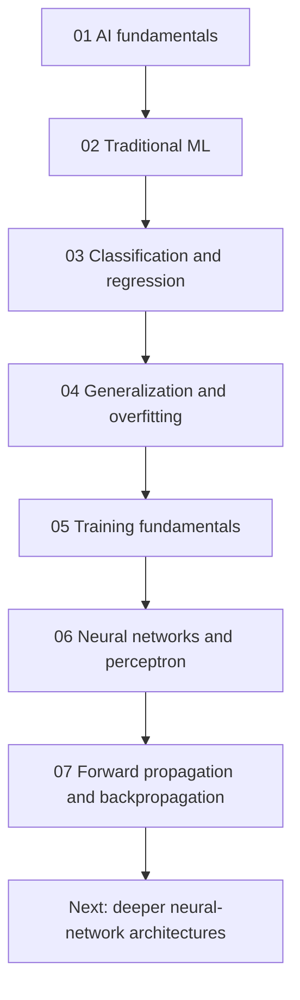

# Phase 1 — Artificial Intelligence Fundamentals

A fundamentals-first learning path for DevOps and infrastructure engineers moving into AI Infrastructure / MLOps.

## Lessons

| # | Lesson | Topics |
|---|---|---|
| 01 | [What Is Artificial Intelligence?](01-what-is-artificial-intelligence.md) | AI, ML, deep learning, GenAI, LLMs, AI lifecycle |
| 02 | [Traditional Machine Learning](02-traditional-machine-learning.md) | Datasets, features, labels, splits, training and inference |
| 03 | [Classification, Regression, and Model Evaluation](03-classification-regression-model-evaluation.md) | Confusion matrix, precision, recall, F1, thresholds |
| 04 | [Overfitting, Underfitting, Bias, and Variance](04-overfitting-underfitting-bias-variance.md) | Generalization, learning curves, regularization |
| 05 | [Model Training Fundamentals](05-model-training-fundamentals.md) | Parameters, weights, biases, loss, optimization, batches |
| 06 | [Neural Networks and the Perceptron](06-neural-networks-perceptron.md) | Neurons, layers, activation functions, forward pass |
| 07 | [How Neural Networks Learn: Forward Propagation, Backpropagation and Gradients](07-forward-propagation-backpropagation-gradients.md) | Forward propagation, loss, gradients, backpropagation, optimizers, training loop |

## Learning sequence

## Progress

See the repository-level [PROGRESS.md](../PROGRESS.md) for completion status and the full 12-phase roadmap.

All lesson diagrams are embedded as Mermaid blocks in the Markdown files. GitHub renders them directly; no separate HTML files or image assets are needed.
