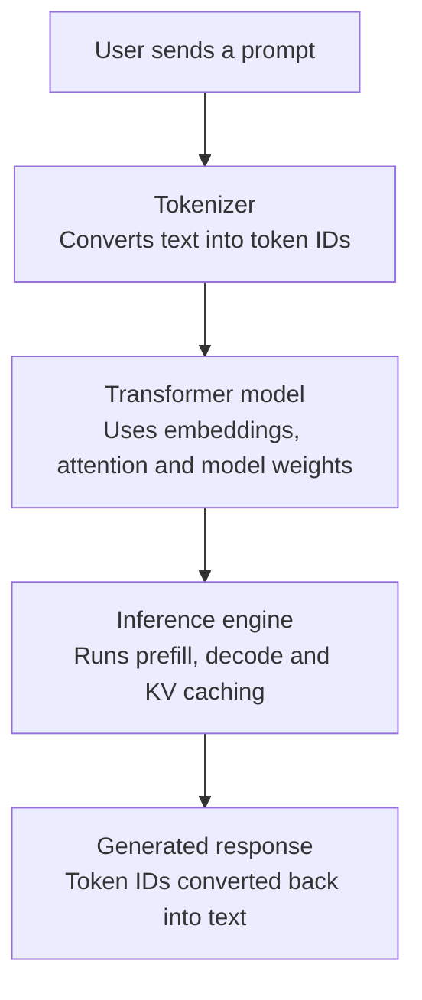

# Where We Will Learn Inference, Tokens and Transformers

Great question! And yes, these are **core topics for your AI Infrastructure transition**. We will cover all three, but at different points in the curriculum.

One important distinction: **inference, tokens and transformers are not one single topic**. They belong to different layers of the AI stack.

Here's where they fit.

## Where each topic is covered

### Phase 1 — AI Fundamentals
**Introduced**

Basic understanding of training versus inference and what a model does when making predictions.

### Phase 2 — Mathematics and Data Fundamentals

Tensors, vectors, matrices, linear algebra and applied mathematics needed to understand neural networks.

### Phase 3 — Deep Learning

Neural networks, layers, activations, forward propagation, backpropagation and introductory PyTorch.

### Phase 4 — LLM Fundamentals
**Major focus: Tokens + Transformers**

- What are tokens?
- Tokenization and tokenizers.
- Vocabulary and context windows.
- Embeddings and positional encoding.
- Attention mechanism.
- Self-attention and multi-head attention.
- Transformer architecture.
- Encoder-only, decoder-only and encoder-decoder models.
- Next-token prediction.
- Pretraining and fine-tuning.

### Phase 5 — LLM Model Engineering

Model formats, quantization, model weights, fine-tuning methods, LoRA and QLoRA, model packaging and evaluation.

### Phase 6 — LLM Inference and Serving
**Major focus: Inference + Model Serving**

- Training versus inference.
- Complete inference request lifecycle.
- Prefill and decode stages.
- KV cache.
- GPU VRAM requirements.
- TTFT and time per output token.
- Tokens per second.
- Batching and continuous batching.
- vLLM, TGI and llama.cpp.
- Streaming APIs and autoscaling.
- Deploying and benchmarking LLMs.

### Phases 7–12

RAG, vector databases, AI application engineering, GPU infrastructure, MLOps/LLMOps, Kubernetes production AI and end-to-end projects.

## How these topics connect

This is the relationship I want you to understand:

And your job as an AI infrastructure engineer is to understand how to deploy, optimize, scale, secure and monitor every relevant component in this pipeline.

## One additional commitment

I don't want you to finish Phase 4 and merely know what a Transformer is.

By the end of Phase 6, you should be able to:

1. Explain how a prompt becomes tokens.
2. Explain how a Transformer processes those tokens.
3. Understand how next-token prediction works.
4. Explain what happens inside an inference engine.
5. Estimate GPU memory requirements for model weights and KV cache.
6. Understand why inference performance changes with context length and concurrency.
7. Deploy an LLM using vLLM on Kubernetes.
8. Benchmark latency, throughput and token generation speed.
9. Troubleshoot GPU memory exhaustion and serving bottlenecks.

**My recommendation:** Keep the current roadmap, but treat Phases 4 and 6 as two of the most important phases for your transition. Phase 4 teaches you how LLMs work; Phase 6 teaches you how to run them in production.

That's where we'll go deep. 🚀
